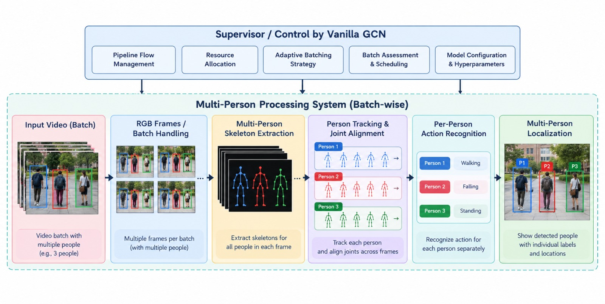

# lightweight-joint-recovery-research

Research on lightweight, compute-selective missing-joint recovery for multi-person skeleton-based action recognition — only recovering joints that are actually occluded, instead of uniform per-joint computation.

## Overview

This repository holds the individual research work behind one of the core contributions of the [lightweight-multiperson-action-recognition](https://github.com/Remi2121/FYP-lightweight-multiperson-action-recognition) framework: a **missing-joint recovery module** for skeleton-based action recognition.

When a camera loses track of a joint — due to occlusion, fast motion, or a bad angle — an action-recognition model fed an incomplete skeleton can easily misclassify the action. Existing work that addresses this, most notably **STSc-GCN** (Li et al., IEEE TIP 2026), compensates for occluded joints *inside* the graph convolutional network itself, using dedicated CMSC and MSTC modules. It is the closest published reference point for this research — but it has two concrete limitations that this project targets directly:

1. **Uniform computation** — STSc-GCN processes every joint with the same fixed computation, whether or not that joint is actually missing. This wastes compute, especially as the number of people in a scene grows.
2. **Single-person, untested-on-edge scope** — it has only been built and evaluated for one person at a time, and has not been shown to run on low-cost edge hardware (Raspberry Pi 5, Jetson Nano).

## Research Question

Can missing-joint recovery be made **compute-selective** — spending extra computation only on the joints that are actually missing — so that it scales efficiently to multiple people on lightweight edge devices, instead of paying a fixed cost per joint regardless of whether recovery is needed?

## Approach

- Detect which joints are actually missing/occluded per frame, per person.
- Apply recovery computation selectively, inferring plausible joint positions from the temporal and skeletal-graph context of the surrounding, correctly detected joints — without increasing the recognition model's overall computational cost when few or no joints are missing.
- Benchmark against STSc-GCN and the other baseline ST-GNN architectures (ST-GCN, 2s-AGCN, MS-AAGCN, RA-GCN, ST-GAT) for accuracy and inference cost, scaling the test from 1 to multiple simultaneous people.
- Validate on real edge hardware (Jetson Nano, Raspberry Pi 5), not just on a desktop GPU.

## Relation to the Main Framework

This module is one of two original research contributions in the team's main framework (the other being adaptive multi-person batching). It plugs into the main pipeline right after person tracking & joint alignment, before per-person action recognition:



*Fig. 1 — Full framework pipeline (from the main [lightweight-multiperson-action-recognition](https://github.com/Remi2121/FYP-lightweight-multiperson-action-recognition) repo). Missing-joint recovery operates within the "Person Tracking & Joint Alignment" stage, before each person's skeleton reaches action recognition.*

## Key Reference

X. Li, Q. Geng, Q. Huang, X. Li, J. Tang, and Q. Ye, "Spatial-temporal self-compensating graph convolutional network for skeleton-based action recognition under data constraints," *IEEE Transactions on Image Processing*, vol. 35, pp. 5818–5833, 2026.

## Project Structure

```
src/
  datasets/pku_mmd.py       -- loads PKU-MMD skeleton + label files into fixed-length clips
  models/graph.py           -- 25-joint Kinect/NTU skeleton graph, spatial configuration partitioning
  models/st_gcn.py          -- ST-GCN baseline backbone (9 layers, edge-importance weighting)
  occlusion.py               -- synthetic joint-occlusion simulation (the controlled test bed)
  recovery_baseline.py      -- naive temporal-interpolation recovery (first-pass baseline)
  train.py                   -- trains the ST-GCN baseline on PKU-MMD
  evaluate_occlusion.py     -- compares clean vs. occluded vs. occluded+recovered accuracy
data/pku_mmd/raw/           -- place the downloaded PKU-MMD dataset here (gitignored, see its README)
```

## Getting Started

```bash
pip install -r requirements.txt

# 1. Place the PKU-MMD dataset under data/pku_mmd/raw/ (see data/pku_mmd/raw/README.md)

# 2. Train the ST-GCN baseline
python -m src.train --raw-dir data/pku_mmd/raw --epochs 30

# 3. Measure accuracy under synthetic occlusion, with and without recovery
python -m src.evaluate_occlusion --raw-dir data/pku_mmd/raw --checkpoint checkpoints/st_gcn_baseline.pt
```

The compute-selective recovery module (the actual research contribution) is the next step, built on top of this working baseline — see the research roadmap below.

## Roadmap

- [x] ST-GCN baseline implementation (25-joint graph, spatial configuration partitioning, edge-importance weighting)
- [x] PKU-MMD dataset loader
- [x] Synthetic occlusion simulation + naive temporal-interpolation recovery baseline
- [ ] Train baseline on real PKU-MMD data, confirm end-to-end accuracy
- [ ] Design and implement compute-selective recovery (detect missing joints, recover only those)
- [ ] Compare accuracy + compute cost: STSc-GCN-style dense recovery vs. selective recovery
- [ ] Scale test to multiple simultaneous people
- [ ] Validate on edge hardware (Jetson Nano, Raspberry Pi 5)

## Status

🚧 Baseline implementation complete (untrained — pending PKU-MMD data access). Compute-selective recovery module in design.
